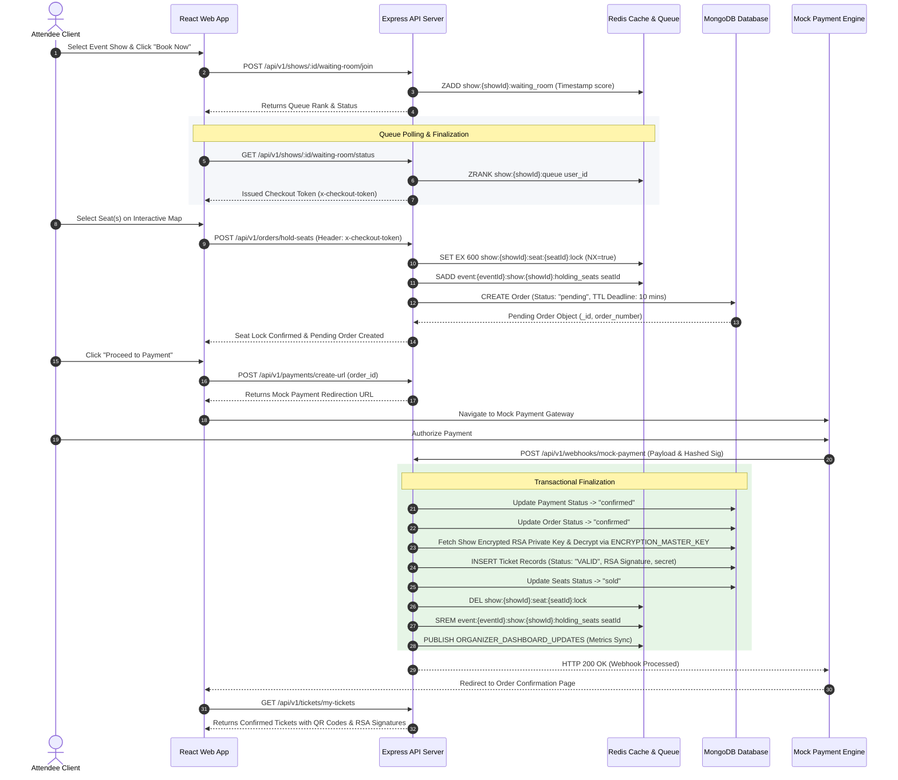

# Tickify - Technical Runbook & Operational Specification

## 1. Metadata Header

| Property | Details |
| :--- | :--- |
| **Project Name** | Tickify (Full-Stack Event Ticketing & Reservation Platform) |
| **Version** | `1.0.0` |
| **Primary Tech Stack** | Node.js (v20 LTS), Express 5.x, TypeScript, React 19, Vite, Redis 7, MongoDB 7, BullMQ |
| **Author** | Poorna Bhagya & DevOps Engineering Group |
| **Last Updated** | 2026-08-06 |
| **Infrastructure Status** | Active / Operational (Production Ready Container Architecture) |
| **Target Execution Environment** | Docker Desktop, Docker Compose v2, Linux/Windows Containerized Stack |

---

## 2. System Overview & Technical Stack Breakdown

Tickify is designed as a multi-tier, microservices-ready web application built to handle high-concurrency event ticket booking, waiting room queue management, temporary seat holds, RSA/TOTP ticket signing, and QR-based offline/online check-ins.

### 2.1 System Architecture Diagram (ASCII)

```
+-----------------------------------------------------------------------------------+
|                                 CLIENT LAYER                                      |
|  +-----------------------------------+    +------------------------------------+  |
|  |     React 19 / Vite Web App       |    |   Expo React Native Scanner App    |  |
|  |  (Attendee, Organizer, Admin UI)  |    |     (Staff QR Check-in Device)     |  |
|  +-----------------+-----------------+    +-----------------+------------------+  |
+--------------------|----------------------------------------|---------------------+
                     | HTTP / HTTPS / SSE                     | HTTP / REST API
                     v                                        v
+-----------------------------------------------------------------------------------+
|                               DOCKER CONTAINER STACK                              |
|                                                                                   |
|  +-----------------------------------------------------------------------------+  |
|  | FRONTEND CONTAINER (Port 5173 / Nginx 80)                                   |  |
|  | - Serves static assets, Vite SPA bundle, Tailwind CSS UI                    |  |
|  +-------------------------------------+---------------------------------------+  |
|                                        | API Requests / Headers                   |
|                                        v                                          |
|  +-----------------------------------------------------------------------------+  |
|  | BACKEND CONTAINER (Port 3000)                                               |  |
|  | - Express REST API Server (TypeScript)                                      |  |
|  | - Auth (JWT & Cookie Sessions), CORS, Compression, SSE Server                |  |
|  | - Crypto Engine (RSA-2048 per-show keypair generation, AES-256 decryption)  |  |
|  | - BullMQ Queue Producers & Consumers                                        |  |
|  +------------------+----------------------------------+-----------------------+  |
|                     |                                  |                          |
|                     v (TCP 6379)                       v (TCP 27017)              |
|  +------------------+------------------+   +-----------+-----------------------+  |
|  | REDIS CONTAINER (Port 6379)         |   | MONGODB CONTAINER (Port 27017)        |  |
|  | - Waiting Room (Sorted Sets)        |   | - Persistent Collections:             |  |
|  | - Seat Holds & Locks (TTL keys)     |   |   Users, Events, Shows, Venues,   |  |
|  | - Zone Summary Caches (Hashes)      |   |   Zones, Seats, TicketTypes,      |  |
|  | - Realtime SSE Pub/Sub Channels     |   |   Orders, Payments, Tickets,      |  |
|  | - BullMQ Queue Engine               |   |   CheckInLogs                     |  |
|  +-------------------------------------+   +-----------------------------------+  |
+-----------------------------------------------------------------------------------+
```

### 2.2 Decoupled Stack Layers Breakdown

| Architectural Tier | Technology / Framework | Network Port / Specs | Primary Responsibilities |
| :--- | :--- | :--- | :--- |
| **Client Web Tier** | React 19, Vite, Tailwind CSS, TanStack Query, Zustand | `5173:5173` (Dev) / `80:80` (Prod Nginx) | User interface for Attendees, Organizers, and Admins. Seatmap interactive canvas rendering via React Konva. |
| **Mobile Scanner Tier**| Expo, React Native, `jsrsasign`, `OTPAuth` | N/A (Runs on iOS/Android native) | Staff ticket scanner app. Performs online REST check-in and offline cryptographic validation (RSA signature + TOTP). |
| **Application API Tier**| Node.js 20 LTS, Express 5.2, TypeScript 6 | `3000:3000` | REST API routes (`/auth`, `/events`, `/shows`, `/orders`, `/tickets`, etc.), middleware authentication, image uploads, crypto operations. |
| **In-Memory Cache & Queue Tier** | Redis 7 Alpine, BullMQ 5.76 | `6379:6379` | High-throughput waiting room sorting, 10-minute temporary seat holding locks, zone summary aggregation, SSE Pub/Sub broadcasting. |
| **Persistent Data Tier**| MongoDB 7.0 Community / ReplicaSet | `27017:27017` | ACID transactional persistence for orders, payment status, encrypted RSA private keys, user profiles, seat definitions, and audit check-in logs. |

---

## 3. Architecture Data Flow Sequence

The diagram below details the end-to-end lifecycle of an event booking request: from waiting room entry, seat locking in Redis, order creation in MongoDB, mock payment completion, signed ticket issuance, to state cleanup.



---

## 4. Local Development & Docker Execution Guide

### 4.1 Prerequisites

Before executing the Tickify platform locally, ensure the following software tools are installed:

- **Node.js**: `v20.x.x LTS` (or `v18.x.x`)
- **npm**: `v10.x.x`
- **Docker Desktop**: `v24.x+` with Docker Compose `v2.x+`
- **Git**: `v2.x+`

---

### 4.2 Step-by-Step Native (Non-Docker npm Mode)

#### 1. Clone Repository & Prepare Workspace
```bash
git clone https://github.com/poornabhagya/tickify.git
cd tickify/tickify
```

#### 2. Run Local Infrastructure (MongoDB & Redis)
If running databases natively via Docker single containers:
```bash
# Launch Redis 7
docker run -d --name tickify-redis -p 6379:6379 redis:7-alpine

# Launch MongoDB 7
docker run -d --name tickify-mongo -p 27017:27017 mongo:7
```

#### 3. Backend Setup & Run
```bash
cd backend
npm install

# Copy environment configuration
cp .env.example .env

# Run database migrations / seed script if needed
npm run build

# Start Backend in Development Mode (with tsx hot-reloading)
npm run dev
```
*Backend API Server will start at `http://localhost:3000/api/v1`*

#### 4. Frontend Setup & Run
Open a new terminal tab/window:
```bash
cd frontend
npm install

# Start Frontend Vite Dev Server
npm run dev
```
*Frontend Application will launch at `http://localhost:5173`*

---

### 4.3 Production Docker & Docker Compose Execution Mode

To achieve single-command, isolated, production-grade container execution, deployment Dockerfiles and a root `docker-compose.yml` are specified below.

#### Backend Dockerfile (`backend/Dockerfile`)
```dockerfile
# Multi-stage Dockerfile for Tickify Backend REST API
FROM node:20-alpine AS builder
WORKDIR /app
COPY package*.json ./
RUN npm ci
COPY . .
RUN npm run build

FROM node:20-alpine AS runner
WORKDIR /app
ENV NODE_ENV=production
COPY package*.json ./
RUN npm ci --only=production
COPY --from=builder /app/dist ./dist
COPY --from=builder /app/src/scripts ./dist/scripts

EXPOSE 3000
CMD ["node", "dist/server.js"]
```

#### Frontend Dockerfile (`frontend/Dockerfile`)
```dockerfile
# Multi-stage Dockerfile for Tickify React Frontend (Nginx Static Serve)
FROM node:20-alpine AS builder
WORKDIR /app
COPY package*.json ./
RUN npm ci
COPY . .
RUN npm run build

FROM nginx:1.25-alpine AS runner
COPY --from=builder /app/dist /usr/share/nginx/html
EXPOSE 80
CMD ["nginx", "-g", "daemon off;"]
```

#### Root Docker Compose (`docker-compose.yml`)
```yaml
version: '3.8'

services:
  mongodb:
    image: mongo:7.0
    container_name: tickify-mongodb
    restart: always
    ports:
      - "27017:27017"
    environment:
      MONGO_INITDB_DATABASE: tickify
    volumes:
      - mongo_data:/data/db
    healthcheck:
      test: ["CMD", "mongosh", "--eval", "db.adminCommand('ping').ok"]
      interval: 10s
      timeout: 5s
      retries: 5

  redis:
    image: redis:7-alpine
    container_name: tickify-redis
    restart: always
    ports:
      - "6379:6379"
    command: redis-server --appendonly yes
    volumes:
      - redis_data:/data
    healthcheck:
      test: ["CMD", "redis-cli", "ping"]
      interval: 10s
      timeout: 5s
      retries: 5

  backend:
    build:
      context: ./backend
      dockerfile: Dockerfile
    container_name: tickify-backend
    restart: always
    ports:
      - "3000:3000"
    environment:
      PORT: 3000
      NODE_ENV: production
      URI: mongodb://mongodb:27017/tickify
      REDIS_HOST: redis
      REDIS_PORT: 6379
      REDIS_URL: redis://redis:6379
      SECRET_ACCESS_TOKEN: prod_access_token_secret_32_chars_min
      JWT_SECRET: prod_checkout_token_secret_32_chars
      ENCRYPTION_MASTER_KEY: 0123456789abcdef0123456789abcdef0123456789abcdef0123456789abcdef
      FRONTEND_URL: http://localhost
      CORS_ALLOWED_ORIGINS: http://localhost,http://localhost:5173
    depends_on:
      mongodb:
        condition: service_healthy
      redis:
        condition: service_healthy

  frontend:
    build:
      context: ./frontend
      dockerfile: Dockerfile
    container_name: tickify-frontend
    restart: always
    ports:
      - "80:80"
    depends_on:
      - backend

volumes:
  mongo_data:
  redis_data:
```

#### Launching via Docker Compose:
```bash
# Build and start all services in detached mode
docker compose up --build -d

# Verify running container status
docker compose ps

# View unified container logs
docker compose logs -f
```

---

### 4.4 Code Quality, Linting & Automated Test Commands

Execute the following commands to validate code quality and run automated test suites:

| Action | Target Subsystem | Command |
| :--- | :--- | :--- |
| **Lint Check** | Frontend | `cd frontend && npm run lint` |
| **Type Check & Build** | Frontend | `cd frontend && npm run build` |
| **Type Check & Build** | Backend | `cd backend && npm run build` |
| **Run Unit Tests** | Backend | `cd backend && npm run test:unit` |
| **Run Integration Tests**| Backend | `cd backend && npm run test:integration` |
| **Full Test Suite** | Backend | `cd backend && npm run test` |
| **Code Coverage** | Backend | `cd backend && npm run test:coverage` |

---

## 5. Environment Variables Reference Guide

### 5.1 Backend Data Dictionary (`backend/.env`)

| Variable Name | Required | Default / Example Value | Description |
| :--- | :--- | :--- | :--- |
| `PORT` | Yes | `3000` | HTTP port on which the Express REST server listens. |
| `NODE_ENV` | Yes | `development` / `production` | Execution environment flag. Controls logging verbosity & static file caching headers. |
| `URI` | Yes | `mongodb://127.0.0.1:27017/tickify` | Mongoose connection string for MongoDB persistence. |
| `REDIS_URL` | Yes | `redis://127.0.0.1:6379` | Full connection URI for Redis cache & BullMQ queue. |
| `REDIS_HOST` | Yes | `127.0.0.1` | Network hostname for Redis instance. |
| `REDIS_PORT` | Yes | `6379` | Network port for Redis service. |
| `REDIS_PASSWORD` | No | `""` | Optional authentication password for Redis server. |
| `SECRET_ACCESS_TOKEN`| Yes | `your_access_token_secret` | HMAC secret key used for signing User authentication JWT tokens. |
| `JWT_SECRET` | Yes | `your_checkout_token_secret` | HMAC secret key used for signing short-lived Checkout/Waiting-Room tokens. |
| `FRONTEND_URL` | Yes | `http://localhost:5173` | Primary frontend web client URL for CORS origin validation. |
| `BACKEND_URL` | Yes | `http://localhost:3000` | Base backend internal origin URL. |
| `BACKEND_PUBLIC_URL` | Yes | `http://localhost:3000` | Publicly accessible backend URL used for static uploaded asset URLs. |
| `CORS_ALLOWED_ORIGINS`| Yes | `http://localhost:5173,http://localhost:4173` | Comma-separated list of additional white-listed CORS origins. |
| `MOCK_PAYMENT_SECRET`| Yes | `your_mock_payment_secret` | Shared secret key for validating payment gateway webhook signatures. |
| `ENCRYPTION_MASTER_KEY`| Yes | `64-hex-character-string` | 256-bit AES master key used to encrypt per-show RSA private keys at rest in MongoDB. |

### 5.2 Frontend Data Dictionary (`frontend/.env`)

| Variable Name | Required | Default / Example Value | Description |
| :--- | :--- | :--- | :--- |
| `VITE_API_URL` | Yes | `http://localhost:3000/api/v1` | Base REST API endpoint URL for Axios and TanStack Query requests. |

---

## 6. Database Schema & Data Dictionary

### 6.1 MongoDB Collections Schema Breakdown

#### 1. `users` Collection (Base Schema with Mongoose Discriminators)
Discriminators: `Attendee`, `Organizer`, `Staff`

| Field Name | Type | Constraints | Description |
| :--- | :--- | :--- | :--- |
| `_id` | ObjectId | Primary Key | Auto-generated unique identifier. |
| `email` | String | Required, Unique, Lowercase | User email address. |
| `password` | String | Required | Salted bcrypt hash of user password. |
| `first_name` | String | Required | First name of user. |
| `last_name` | String | Required | Last name of user. |
| `phone` | String | Required | Phone number. |
| `role` | String | Discriminator Key (`User`, `Organizer`, `Staff`, `Admin`) | Defines access level and extended fields. |
| `company_name` | String | Required (Organizer only) | Registered business name for event organizers. |
| `tax_id` | String | Required, Unique (Organizer only)| Tax registration ID. |
| `is_verified` | Boolean | Default: `false` (Organizer) | Admin verification status. |
| `assigned_show_ids`| Array[ObjectId] | Ref: `Show` (Staff only) | List of shows assigned for QR check-in scanning. |
| `organizer_id` | ObjectId | Ref: `User` (Staff only) | Employer organizer ID. |
| `created_at` | Date | Default: `Date.now` | Creation timestamp. |

#### 2. `events` Collection
| Field Name | Type | Constraints | Description |
| :--- | :--- | :--- | :--- |
| `_id` | ObjectId | Primary Key | Unique event ID. |
| `name` | String | Required | Title of the event. |
| `description` | String | Optional | Markdown or plaintext description. |
| `genre` | String | Optional | Genre classification (e.g., Music, Conference). |
| `poster_url` | String | Optional | Relative URL of uploaded poster image. |
| `banner_url` | String | Optional | Relative URL of uploaded banner image. |
| `start_date` | Date | Required | Overall event start date. |
| `end_date` | Date | Required | Overall event end date. |
| `status` | String | Enum: `['draft', 'published', 'cancelled']` | Operational status of event. |
| `organizer_id` | ObjectId | Ref: `Organizer`, Required | Owning organizer ID. |

#### 3. `shows` Collection
| Field Name | Type | Constraints | Description |
| :--- | :--- | :--- | :--- |
| `_id` | ObjectId | Primary Key | Unique show instance ID. |
| `event_id` | ObjectId | Ref: `Event`, Required | Parent event reference. |
| `name` | String | Required | Show session title (e.g., "Night 1"). |
| `sale_start` | Date | Required | Ticket sale opening timestamp. |
| `sale_end` | Date | Required | Ticket sale closing timestamp. |
| `start_time` | Date | Required | Show performance start time. |
| `end_time` | Date | Required | Show performance end time. |
| `venue_id` | ObjectId | Ref: `Venue`, Required | Show location reference. |
| `organizer_id` | ObjectId | Ref: `Organizer`, Required | Owning organizer reference. |
| `status` | String | Enum: `['draft', 'published', 'cancelled']` | Show lifecycle state. |
| `public_key` | String | Required, Unique | RSA-2048 Public Key for offline QR verification. |
| `encrypted_private_key`| String | Required, Unique | AES-256 encrypted RSA Private Key. |

#### 4. `seats` Collection
| Field Name | Type | Constraints | Description |
| :--- | :--- | :--- | :--- |
| `_id` | ObjectId | Primary Key | Unique seat ID. |
| `seat_number` | String | Required | Display label (e.g., "A-12"). |
| `row` | String | Optional | Row designation. |
| `col_index` | Number | Optional | Column index in grid layout. |
| `zone_id` | ObjectId | Ref: `Zone`, Required | Zone reference. |
| `show_id` | ObjectId | Ref: `Show`, Required | Show reference. |
| `status` | String | Enum: `['available', 'reserved', 'sold', 'blocked']` | Current persistent availability status. |
| `ticket_type_id` | ObjectId | Ref: `TicketType` | Price tier assignment. |

#### 5. `orders` Collection
| Field Name | Type | Constraints | Description |
| :--- | :--- | :--- | :--- |
| `_id` | ObjectId | Primary Key | Unique order ID. |
| `order_number` | String | Required, Unique | Human-readable tracking number (e.g., `ORD-1722975200-ABCD`). |
| `user_id` | ObjectId | Ref: `Attendee`, Required | Purchaser reference. |
| `show_id` | ObjectId | Ref: `Show`, Required | Target show ID. |
| `items` | Array[Object] | Required | Array containing `{ seat_id, ticket_type_id, price }`. |
| `status` | String | Enum: `['pending', 'confirmed', 'cancelled']` | Order state. |
| `total_price` | Number | Required | Final total monetary price. |
| `cancellation_deadline`| Date | Optional | Expiration time for pending payment (10 mins). |

#### 6. `tickets` Collection
| Field Name | Type | Constraints | Description |
| :--- | :--- | :--- | :--- |
| `_id` | ObjectId | Primary Key | Unique ticket ID. |
| `order_id` | ObjectId | Ref: `Order`, Required | Originating order reference. |
| `user_id` | ObjectId | Ref: `User`, Required | Ticket owner reference. |
| `show_id` | ObjectId | Ref: `Show`, Required | Show reference. |
| `seat_id` | ObjectId | Ref: `Seat`, Required | Reserved physical seat. |
| `ticket_secret` | String | Required | Cryptographic secret for TOTP computation. |
| `signature` | String | Required | RSA-2048 signature of ticket payload. |
| `status` | String | Enum: `['VALID', 'USED', 'INVALID']` | Check-in status. |
| `check_in_time` | Date | Optional | Timestamp when scanned/used. |

#### 7. `checkinlogs` Collection
| Field Name | Type | Constraints | Description |
| :--- | :--- | :--- | :--- |
| `_id` | ObjectId | Primary Key | Audit log ID. |
| `ticket_id` | ObjectId | Ref: `Ticket`, Optional | Validated ticket ID. |
| `show_id` | ObjectId | Ref: `Show`, Required | Show ID. |
| `staff_id` | ObjectId | Ref: `Staff`, Required | Scanner staff user ID. |
| `mode` | String | Enum: `['ONLINE', 'OFFLINE_SYNC']` | Check-in operational mode. |
| `result` | String | Enum: `['SUCCESS', 'DUPLICATE', 'INVALID', 'EXPIRED', 'NOT_FOUND', 'CONFLICT', 'ERROR']` | Scanner validation outcome. |
| `scanned_at` | Date | Required | Device scanning timestamp. |

---

### 6.2 Redis Key Schema Data Dictionary

| Redis Key Pattern | Data Structure | TTL / Expiration | Operational Function |
| :--- | :--- | :--- | :--- |
| `show:{showId}:waiting_room` | Sorted Set (ZSET) | None (cleared upon queue launch) | Pre-sale arrival queue (score = arrival epoch timestamp). |
| `show:{showId}:queue` | Sorted Set (ZSET) | None (cleared post-sale) | Active checkout queue order (score = randomized priority score). |
| `show:{showId}:queue_finalized` | String | `1800s` (30 mins) | Flag key marking that the pre-sale queue calculation has completed. |
| `event:{eId}:show:{sId}:seat:{seatId}:lock` | String | `600s` (10 mins) | Temporary seat hold key containing `user_id`. Prevents double-booking during checkout. |
| `event:{eId}:show:{sId}:holding_seats` | Set (SET) | Dynamic | Set of all seat IDs currently locked in hold state. |
| `show:{showId}:seat_status` | Hash (HASH) | Dynamic | High-performance lookup mapping `seat_id` -> status (`available`/`reserved`/`sold`). |
| `show:{showId}:seats_static_layout` | String (JSON) | `86400s` (24 hrs) | Cached static seatmap geometric layout payload for fast React Konva rendering. |
| `event:{eId}:show:{sId}:zone:{zId}:summary`| Hash (HASH) | Dynamic | Realtime zone availability metrics (`totalSeats`, `availableSeats`, `holdingSeats`, `soldSeats`). |
| `event:{eId}:show:{sId}:total_revenue` | String (Counter)| Dynamic | Atomic numerical counter for real-time sales revenue. |
| `event:{eId}:show:{sId}:sold_count` | String (Counter)| Dynamic | Atomic numerical counter for overall tickets sold. |
| `blacklist:{token}` | String | Matches JWT Expiry (`3600s`) | Revoked JWT access tokens recorded upon user logout. |

---

## 7. Operational Troubleshooting & Incident Response Runbook

### Incident Scenario A: MongoDB Connection Failures / Timeout

#### Symptom
Backend API logs output `MongooseServerSelectionError: connect ECONNREFUSED 127.0.0.1:27017` or HTTP status `500 Internal Server Error` on data-persisting routes.

#### Root Cause Analysis
1. MongoDB container or daemon crashed due to resource pressure or ungraceful shutdown.
2. Network misconfiguration in Docker network bridge (e.g., backend attempting to connect to `127.0.0.1` inside container instead of service hostname `mongodb`).
3. Connection pool exhaustion caused by unindexed queries blocking database driver sockets.

#### Mitigation & Resolution Workflow
1. **Verify MongoDB Service Status**:
   ```bash
   docker compose ps mongodb
   docker compose logs --tail=100 mongodb
   ```
2. **Execute Database Ping Test**:
   ```bash
   docker compose exec mongodb mongosh --eval "db.adminCommand('ping')"
   ```
3. **Inspect Connection String in Backend**:
   Ensure `URI` in `backend/.env` references `mongodb://mongodb:27017/tickify` when running inside Docker, or `mongodb://127.0.0.1:27017/tickify` in native execution.
4. **Restart Database Container**:
   ```bash
   docker compose restart mongodb
   ```

---

### Incident Scenario B: Redis Cache Unavailability / Fallback Behavior

#### Symptom
Backend logs display `Redis Client Error: ConnectionRefused` or `Lỗi kết nối Redis`. Booking waiting room or seat holding fails.

#### Root Cause Analysis
Redis instance is down, network port `6379` is blocked, or out-of-memory (OOM) eviction occurred.

#### Fallback Architecture Mechanics
The Tickify codebase incorporates defensive Redis error handling via `isRedisUnavailableError()` (`backend/src/utils/redisErrors.ts`). When Redis fails:
- Read-heavy queries (such as seat map layouts or zone availability) fall back directly to primary MongoDB collection reads (`Seat.find()`, `Zone.find()`).
- Writes bypass Redis non-critical caches gracefully without throwing catastrophic unhandled promise rejections.

#### Mitigation & Resolution Workflow
1. **Verify Redis Container & Memory**:
   ```bash
   docker compose exec redis redis-cli ping
   docker compose exec redis redis-cli info memory
   ```
2. **Clear Corrupted Redis Cache State (If Needed)**:
   ```bash
   docker compose exec redis redis-cli FLUSHDB
   ```
3. **Restart Redis Container**:
   ```bash
   docker compose restart redis
   ```

---

### Incident Scenario C: CORS Preflight Errors between React Frontend and Node API

#### Symptom
Browser console displays `Access to XMLHttpRequest at 'http://localhost:3000/api/v1/...' from origin 'http://localhost:5173' has been blocked by CORS policy: Response to preflight request doesn't pass access control check`.

#### Root Cause Analysis
1. The requesting client origin is missing from `allowedOrigins` array defined in `backend/src/app.ts`.
2. Custom HTTP headers sent by the frontend (e.g., `x-checkout-token`, `x-sync-key`) were not explicitly permitted in `allowedHeaders`.

#### Mitigation & Resolution Workflow
1. **Inspect Allowed Origins Configuration**:
   Verify `CORS_ALLOWED_ORIGINS` in `backend/.env`:
   ```env
   CORS_ALLOWED_ORIGINS=http://localhost:5173,http://localhost:4173,http://localhost:3000
   ```
2. **Verify Headers Mappings in `backend/src/app.ts`**:
   Ensure preflight configuration explicitly accepts required headers:
   ```typescript
   allowedHeaders: ['Content-Type', 'Authorization', 'x-checkout-token', 'x-sync-key']
   ```
3. **Restart Backend Service**:
   ```bash
   docker compose restart backend
   ```

---

### Incident Scenario D: Docker Container Restart Loops & Memory Throttling

#### Symptom
`docker compose ps` shows `tickify-backend` with status `Restarting (137)`. Container abruptly terminates during high concurrency ticket release events.

#### Root Cause Analysis
Linux kernel Out-Of-Memory (OOM) Killer terminated the Node.js container process because V8 heap memory exceeded the host or container memory limits (Exit Code 137).

#### Mitigation & Resolution Workflow
1. **Inspect OOM Crash Logs**:
   ```bash
   docker inspect tickify-backend --format='{{.State.ExitCode}}'
   docker compose logs --tail=200 backend
   ```
2. **Tune Node.js Max Old Space Size & Docker Resource Limits**:
   Update `docker-compose.yml` backend service definition to grant appropriate memory headroom and configure Node heap size:
   ```yaml
   backend:
     environment:
       NODE_OPTIONS: "--max-old-space-size=2048"
     deploy:
       resources:
         limits:
           memory: 2560M
         reservations:
           memory: 1024M
   ```
3. **Re-deploy Updated Containers**:
   ```bash
   docker compose up -d --no-deps --build backend
   ```
